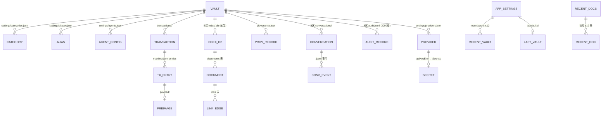

# 数据库设计

> 状态：阶段 08 设计稿 v1.0（2026-11-18），已通过设计交接检查并修订，用户 2026-11-18 审核通过。
> 适用需求：[PRD.md](PRD.md) v1.5；技术方案：[技术设计.md](技术设计.md) v1.0；接口契约：与 API.md 协同（接口签名不在本文）。
> 结构权威来源：`.mile-kb/` 内 JSON 以旧版源码为准（本文逐项标注来源行号）；SQLite schema 以阶段 10 的迁移文件为准（本文写设计与理由）；应用数据文件以本文为准。

## 1. 依据、范围与结构权威来源

本项目没有中心数据库。「数据」分三处，各自的权威来源不同，不能混用：

| 区 | 位置 | 装什么 | 权威来源 | 兼容承诺 |
| --- | --- | --- | --- | --- |
| A 库内 `.mile-kb/` | 知识库根目录下 | 设置（agents / categories / aliases / providers）、事务 `transactions/`、来源记录 `provenance.json` | **旧版源码**（`Mile-Knowledge-Base-master/src/`），本文给出逐项行号 | 与旧版字节级兼容，新旧版可轮流打开同一库（PRD 10.3 / D-003） |
| B 应用数据 | `mygo.App.Path(mygo.PathUserData)`（identifier 阶段 10 定） | 应用设置、最近文档、操作日志、对话历史、每库一个 SQLite 索引库 | **本文**（旧版只读导入其中两个文件，D-003） | 新版自定，不要求与旧版兼容 |
| C Windows 凭据管理器 | `mygo.Secrets` | API key | PRD FR-AI-PROV；上限 2560 字节（`mygo.MaxSecretSize`） | 旧版 key 用 Electron safeStorage 加密，读不出，用户重填（Q2 / D-003） |

普通 `.md` 文件永远是内容唯一事实源；A 区和 B 区里凡是能由文件推导的数据（索引、健康检查报告）都是派生数据，可删可重建。

读写纪律（三区通用）：所有 JSON 一律 `MarshalIndent(obj, "", "  ")` + 结尾 `\n`、UTF-8 无 BOM、LF；原子写入（同目录临时文件 + rename）；读盘数据逐字段校验，非法值回退默认或丢弃该条；损坏文件先备份为 `*.corrupt` 再按默认值运行（FR-SET）。

## 2. 实体、关系与生命周期



| 实体 | 归属 | 生命周期 | 关联需求 |
| --- | --- | --- | --- |
| 知识库（vault） | `recentVaults` 登记项 | 登记 → 打开/断开 ↔ 移除（清 revision、最近文档、索引库，对话历史保留） | FR-VLT |
| 文档 | 库内 `.md` 等文件，唯一事实源 | 创建/编辑/移动/归档/回收站/永久删除；revision 指纹（大小+mtime+sha256）跟踪 | FR-DOC |
| 链接边 | `links` 表（派生） | 随文档解析重建；`to_path` NULL=断链 | FR-LINK |
| 变更计划 | 内存态，确认后执行 | planned → executing → completed/partial/failed | FR-MUT |
| 事务 | `.mile-kb/transactions/<tx-id>/` | open → committed/partial；长期保留供恢复 | FR-MUT |
| 操作记录 | B 区操作日志 | 每次尝试一条，2000 条上限裁最旧 | FR-MUT |
| 来源记录 | `.mile-kb/provenance.json` | 复制到 `projects/` 时写入；副本删除则记录成孤儿 | FR-PROV |
| 对话/事件 | B 区 `conversations/<vaultId>/` | 新建 → 追加事件 → 重命名/置顶/删除/清空；≥4 MiB 新一轮开新对话 | FR-AI-HIST |
| 应用设置 | B 区 `settings.json` | 载入 → patch → 原子写回 | FR-SET |
| 供应商 | `.mile-kb/settings/providers.json`（≤50，无 key） + Secrets key | 增删改；key 单独存取 | FR-AI-PROV |
| Agent 配置 | `.mile-kb/settings/agents.json`（4 个固定 key） | 载入默认值 → patch | FR-AI-AGT |
| 最近文档 | B 区 `recent-documents.json` | 打开文档去重置顶，每库 ≤12；移除库时清 | FR-OVW |

## 3. A 区：`.mile-kb/` 字节级兼容格式

### 3.0 目录总览与存在性核对

```text
<vault>/.mile-kb/
├── config.json          # 旧版仅在禁写前缀注释中出现，无读写实现 → 旧版未实现，新版不创建
├── index/               # 旧版仅在禁写前缀注释中出现，索引实际存 userData → 旧版未实现，新版不创建
├── drafts/              # 草稿暂存区（系统区，Agent 禁写）；旧版无落盘实现（settingsDrafts.ts 是内存态） → 不创建格式约定
├── provenance.json      # 来源追踪表（§3.4）
├── skill-sources.json   # GitHub 来源技能的记录（§3.8，M5 新增，新版独有）
├── transactions/<tx-id>/
│   ├── manifest.json    # 事务清单（§3.5）
│   └── payload/<sha256> # pre-image 文件内容
└── settings/
    ├── agents.json      # Agent 配置（§3.1）
    ├── categories.json  # 分类映射（§3.2）
    ├── aliases.json     # 目录别名（§3.3）
    └── providers.json   # 供应商定义（§3.6，不含 key）
```

依据：`agentPolicy.ts:21-26`（`GLOBAL_WRITE_DENY_PREFIXES` 注释列出的禁写前缀）、`agentPolicy.ts:43-44`（drafts 禁写）；`vaultScaffold.ts` 不创建 `.mile-kb`（dot 目录由应用懒创建）。`config.json` 与 `index/` 在旧版源码中除注释外无任何读写代码，标记「旧版未实现，新版不创建」。`drafts/` 旧版无落盘实现（`settingsDrafts.ts` 是内存态草稿登记，不写文件）；FR-OVW 的「草稿数」磁贴只需统计目录文件数，不需格式约定。

### 3.0.1 兼容读写的总规则（字节级）

- 序列化：与旧版完全相同的 `JSON.stringify(obj, null, 2) + "\n"`。Go 侧用 `json.MarshalIndent` 加手动补 `\n`。注意 Go 的 `MarshalIndent` 默认会把 `<`、`>`、`&` 转义为 `<` 等，而 JS `JSON.stringify` 不会 —— **必须 `SetEscapeHTML(false)`**（用 `json.Encoder`），否则含 HTML 字符的 steering、alias 写出的字节与旧版不同。
- 键序：JSON 对象键按旧版声明顺序写（Go 的 `map` 遍历顺序随机，必须用 `struct` 或 `json.RawMessage` 逐键拼装）。`provenance.json` 另有稳定序列化规则（§3.4）。
- 未知字段：新版**不新增字段、不改名字段**。读取时保留未知字段（`json.RawMessage` 或 `map[string]json.RawMessage` 合并策略），写回时原样带出。理由：旧版的读-改-写是字段级重建（`coerce*`/`normalize*` 只取已知字段组装新对象，如 `coerceAgentConfig` AppConfigStore.ts:65-100、`normalizeProviderDraft` appConfig.ts:208-286、`coerceRecentDocuments` recentDocuments.ts:47-65），旧版自己写回时会丢未知字段；但「轮流打开」要求新版不放大丢失 —— 新版若也字段级重建，用户在旧版手加的字段经新版一次写回就没了。新版保留未知字段，旧版随后写回时丢不丢由旧版决定，不在新版责任范围；新版自身保证「读到的每个键都能写回去」。
- 例外：`transactions/<tx-id>/manifest.json` 旧版 `read` 用 `JSON.parse` 直接转类型、不重建（TransactionService.ts:190-194），且 `commitWithAfterImages` 会重写整个 manifest（TransactionService.ts:162-177），未知字段在旧版写回时同样会丢。新版同样读回保留、写回带出。
- 数值：旧版 `baseRevision` 等数字字段读入时非 number 回退 0；`steeringBaseVersion` 非整数回退默认。新版同口径。

### 3.1 settings/agents.json（4 个 Agent 配置）

来源：`AppConfigStore.ts:65-100, 214-227`、`appConfig.ts:302-316`。

顶层对象，键固定 4 个（`curator`、`scout`、`distiller`、`general`，`AGENT_IDS` agent.ts:16），顺序按声明序。

| 字段 | 类型 | 必填 | 默认 | 上限 / 规则 | 旧版来源 |
| --- | --- | --- | --- | --- | --- |
| `model` | string | 是 | distiller `"deepseek-v4-pro"`，其余 `"deepseek-v4-flash"`（D-010；旧版为 `""`）；`""` 表示用供应商默认模型 | 读入截 128 字符；供应商中找不到时回落默认模型 | appConfig.ts:304；D-010 |
| `effort` | string | 是 | `"high"`（D-010；旧版为 `"auto"`）；**缺键用默认，非法值归一 `auto`** | `auto \| disabled \| low \| high \| max` | appConfig.ts:31-32, 305；agent.ts:43-45；D-010 |
| `approval` | string | 是 | scout `"auto"`，其余 `"ask"`（D-010；旧版 4 个都是 `"ask"`）；**缺键用默认，非法值一律回退 `ask`**（含 scout：降级只能变严格） | `ask \| auto \| yolo` | appConfig.ts:306；AppConfigStore.ts:88-89；D-010 |
| `skillPaths` | string[] | 是 | `[]` | 每条 ≤1024 字符、`/` 分隔、非绝对、无盘符、无 dot 段；去重；最多 500 条 | AppConfigStore.ts:44, 69-80 |
| `steering` | string | 是 | 见 `DEFAULT_AGENT_CONFIGS` | ≤4000 字符；读取时 `slice(0,4000)`；超出时由调用方 `clampSteering` 追加 `[已截断：steering 超过 4000 字符]` | appConfig.ts:300, 313, 330-374 |
| `steeringBaseVersion` | number | 是 | 1 | 非整数回退默认 | appConfig.ts:315；AppConfigStore.ts:95-98 |

写入：整个 agents map `JSON.stringify(agents, null, 2) + "\n"` 原子写（AppConfigStore.ts:214-227）。新版同样整文件写回；未知顶层键（非 4 个 agent id 的键）读取时丢弃（`coerceAgentMap` 只迭代 `AGENT_IDS`，AppConfigStore.ts:102-109），未知 agent 内字段保留写出（见 §3.0.1）。

### 3.2 settings/categories.json（一级目录分类）

来源：`appConfig.ts:400-485`、`AppConfigStore.ts:178-184`。

顶层是**数组**不是对象。

| 字段 | 类型 | 必填 | 默认 | 上限 / 规则 | 旧版来源 |
| --- | --- | --- | --- | --- | --- |
| `directory` | string | 是 | — | 单层目录名，≤64 字符，不含 `[\\/:*?"<>\|]`，非 `.`/`..`；大小写不敏感去重 | appConfig.ts:443-453, 462-467 |
| `alias` | string | 是 | `""`（用目录名） | ≤64 字符 | appConfig.ts:440, 469-470 |
| `area` | string \| null | 是 | `null`（沿用自动分类） | 合法值 `skills\|raws\|archives\|projects\|tools\|wiki\|constraints\|system\|other` 或 `null` | appConfig.ts:405, 474, 489-491 |
| `indexed` | boolean | 否 | `defaultIndexedFor(directory)`：被 `classifyTopLevel` 判为系统区的目录默认 `false`，其余 `true` | — | appConfig.ts:411-414, 422-424, 477 |
| `order` | number | 是 | 0 | 非有限数回退 0 | appConfig.ts:478-481 |

条目数上限 200（`MAX_CATEGORIES` appConfig.ts:438）。「与默认无异」的条目不落盘（`isMeaningfulCategory` appConfig.ts:430-436）：`alias==""` 且 `area==null` 且 `indexed==defaultIndexedFor(directory)` 的条目跳过不写入文件。新版写入前同样过滤。

### 3.3 settings/aliases.json（目录别名）

来源：`appConfig.ts:59-89`、`AppConfigStore.ts:186-207`。

顶层是**对象** `Record<path, alias>`。

| 项 | 规则 | 旧版来源 |
| --- | --- | --- |
| key | vault 相对目录路径，`/` 分隔归一（`\` 也接受并归一）；≤1024 字符；非绝对、无盘符、无 dot 段；非法 key 丢弃 | appConfig.ts:59-66, 78-88 |
| value | 非空字符串；≤64 字符（`MAX_ALIAS_TEXT_LENGTH`）；空串/空白 value 写入时删除该条 | appConfig.ts:54, 74-87；AppConfigStore.ts:199-204 |

条目数上限 2000（FR-AREA）。

### 3.4 provenance.json（来源追踪）

来源：`provenance.ts:113-156`、`ProvenanceService.ts`。

```json
{ "version": 1, "records": [ { "copyPath", "sourcePath", "baseRevision", "baseHash", "copiedAt" } ] }
```

| 字段 | 类型 | 必填 | 说明 | 旧版来源 |
| --- | --- | --- | --- | --- |
| `version` | number | 是 | 固定 1 | provenance.ts:125 |
| `records[].copyPath` | string | 是 | 副本 vault 相对路径；同一 copyPath 只一条 | provenance.ts:16 |
| `records[].sourcePath` | string | 是 | 来源 vault 相对路径 | provenance.ts:17 |
| `records[].baseRevision` | number | 是 | 复制时来源 revision；非 number→0 | provenance.ts:19, 150 |
| `records[].baseHash` | string | 是 | 复制时来源内容 sha256 hex；空串=缺基线（状态 unknown） | provenance.ts:20, 151 |
| `records[].copiedAt` | string | 是 | ISO 8601；非 string→`""` | provenance.ts:22, 152 |

**稳定序列化**（`serializeProvenance` provenance.ts:113-126）：records 按 `copyPath` 升序 `localeCompare`；每条键固定顺序 `copyPath, sourcePath, baseRevision, baseHash, copiedAt`；顶层 `{version, records}`；2 空格缩进 + 结尾 `\n`。该文件进 vault 会被 Git 跟踪，不稳定序列化制造无意义 diff —— 新版必须逐字节复刻此序列化。

只在复制到 `projects/`（`PROVENANCE_TRACKED_PREFIX`，大小写不敏感 `toLowerCase().startsWith("projects/")`）时记录（provenance.ts:159-167）。7 状态判定见 `assessProvenance`（provenance.ts:57-107），只有 `source-changed` 提供同步；判定是运行时计算，不落盘状态字段。

### 3.5 transactions/<tx-id>/（事务）

来源：`TransactionService.ts`。

tx id：`${Date.now().toString(36)}-${randomUUID().slice(0,8)}`（TransactionService.ts:96），目录名按时间自然排序。`manifest.json`：

| 字段 | 类型 | 必填 | 说明 | 旧版来源 |
| --- | --- | --- | --- | --- |
| `id` | string | 是 | tx id | TransactionService.ts:44 |
| `vaultId` | string | 是 | — | TransactionService.ts:45 |
| `planId` | string | 是 | — | TransactionService.ts:46 |
| `createdAt` | string | 是 | ISO 8601 | TransactionService.ts:47 |
| `status` | string | 是 | `open \| committed \| partial` | TransactionService.ts:27, 48 |
| `note` | string | 否 | partial 时说明 | TransactionService.ts:49 |
| `entries[]` | object[] | 是 | 见下 | TransactionService.ts:50 |
| `entries[].path` | string | 是 | vault 相对，`/` 分隔；写入前过 `assertSafeRelative`（无盘符、无 `/` 开头、无空/dot/`..` 段） | TransactionService.ts:33, 83-91 |
| `entries[].kind` | string | 是 | `file \| directory \| absent`；`absent`=事务前不存在，恢复=删除 | TransactionService.ts:30, 34 |
| `entries[].hash` | string | file 才有 | 内容 sha256 hex | TransactionService.ts:36 |
| `entries[].size` | number | file 才有 | 字节数 | TransactionService.ts:37 |
| `entries[].afterHash` | string | 否 | `commitWithAfterImages` 时记录 | TransactionService.ts:39, 172 |
| `entries[].afterKind` | string | 否 | `file \| directory \| absent` | TransactionService.ts:40, 167-172 |

pre-image：`payload/<sha256(path)>`，文件名 = 相对路径的 SHA-256 十六进制（无扩展名），`payloadName` TransactionService.ts:64-66。目录只记 `kind:"directory"` 不复制子树（TransactionService.ts:115-141）。manifest 每次 persist 是 tmp + rename 原子写（TransactionService.ts:314-320）。恢复前逐条比对 after-image，外部又改过 → conflicted 不覆盖（TransactionService.ts:285-312）。

### 3.6 settings/providers.json（供应商定义，无 key）

来源：`ProviderStore.ts:38-60`、`appConfig.ts:100-286`。

```json
{ "version": 1, "providers": [ { "name","kind","baseUrl","models","defaultModel","apiKeyEnv","contextWindow" } ] }
```

| 字段 | 类型 | 必填 | 上限 / 规则 | 旧版来源 |
| --- | --- | --- | --- | --- |
| `version` | number | 是 | 固定 1 | ProviderStore.ts:57 |
| `providers[].name` | string | 是 | ≤64 字符，`^[A-Za-z0-9][A-Za-z0-9_.-]*$`；**读取**时同名（区分大小写）只留第一个，**保存**时同名（忽略大小写）整单拒绝 | appConfig.ts:135, 178-183；ProviderStore.ts:70-73；validate.ts:638-641 |
| `providers[].kind` | string | 是 | `openai \| anthropic`；其他值整条丢弃 | appConfig.ts:100, 223-225 |
| `providers[].baseUrl` | string | 是 | http/https，host 非空，≤512 字符 | appConfig.ts:136, 163-176, 227-230 |
| `providers[].models` | string[] | 是 | 每个 ≤128 字符，最多 32 个；至少 1 个非空；去重 | appConfig.ts:138-139, 242-260 |
| `providers[].defaultModel` | string | 是 | 必须在 models 中；缺省/不在表中回退 `models[0]` | appConfig.ts:108, 262-265 |
| `providers[].apiKeyEnv` | string | 是 | `^[A-Za-z_][A-Za-z0-9_]*$` ≤96 字符；空串=无需鉴权 | appConfig.ts:111, 137, 150-154, 232-239 |
| `providers[].contextWindow` | number | 否 | 正整数；省略则不写键 | appConfig.ts:112, 267-272 |

供应商数上限：读取与迁移最多保留 50 条（`ProviderStore.ts:36`），保存最多 32 条且超出即拒绝（`validate.ts:618`）。文件**不含 key**；key 用 `apiKeyEnv` 变量名关联 Secrets（新版）或 safeStorage（旧版）。

**旧版迁移**：providers.json 不存在或不可读时旧版会读 `<vault>/reasonix.toml` 的托管区 `# >>> mile-knowledge-base managed providers` … `# <<<` 解析 `[[providers]]` 块（ProviderStore.ts:43-53, 92-120）。新版沿用此迁移：只读、不写 reasonix.toml；迁移结果为空则不写 providers.json（避免阻断下次迁移）。

### 3.7 新旧版读 / 写角色

| 文件 | 新版读 | 新版写 | 说明 |
| --- | --- | --- | --- |
| settings/agents.json | 是 | 是 | 设置页 Agents 分节 |
| settings/categories.json | 是 | 是 | 分类与检索分节 |
| settings/aliases.json | 是 | 是 | 目录别名 |
| settings/providers.json | 是 | 是 | 模型服务分节 |
| provenance.json | 是 | 是 | 复制到 projects/ 时 |
| skill-sources.json | 是 | 是 | M5 新增，新版独有；旧版不读不写，轮流打开不受影响 |
| transactions/*/manifest.json + payload/ | 是 | 是 | 变更事务 |
| config.json | 否 | 否 | 旧版未实现 |
| index/ | 否 | 否 | 旧版未实现（索引在 B 区） |
| drafts/ | 否（仅数文件数） | 否 | 无格式约定 |

### 3.8 skill-sources.json（GitHub 来源技能，M5）

> 状态：用户 2026-11-21 审核通过（随 docs/PLAN-M5.md v0.1 批准）。放在知识库内是用户 2026-11-21 的选择（PRD FR-SKM-SRC「随知识库走」，D-016）。旧版没有这个文件，§3.0.1 的「不新增字段」针对旧版已有文件，这里是新文件，不冲突。

```json
{
  "version": 1,
  "records": [
    {
      "skillPath": "skills/文档/pdf",
      "owner": "anthropics",
      "repo": "skills",
      "ref": "main",
      "path": "skills/pdf",
      "commit": "<40 位十六进制>",
      "pathCommit": "<40 位十六进制>",
      "baseHash": "sha256:<hex>",
      "installedAt": "2026-11-21T09:00:00Z"
    }
  ]
}
```

| 字段 | 必填 | 说明 |
| --- | --- | --- |
| `skillPath` | 是 | 知识库相对路径 `skills/<分类>/<技能>`；同一路径只一条 |
| `owner` / `repo` | 是 | 规则见 API §13.3 |
| `ref` | 是 | 安装时用的分支或标签；没写时记默认分支名 |
| `path` | 是 | 仓库内子路径，`''` 表示仓库根 |
| `commit` | 是 | 下载时钉住的头部提交 SHA |
| `pathCommit` | 是 | 该子路径在 `commit` 时的最近一次提交 SHA，更新检测拿它比较 |
| `baseHash` | 是 | 安装 / 上次更新后技能目录的内容哈希（与 4.6 `baseHash` 同算法），判断本地是否改过 |
| `installedAt` | 是 | ISO 8601 |

- 稳定序列化：键序固定为上表顺序，2 空格缩进 + 结尾 `\n`，`SetEscapeHTML(false)`；records 按 `skillPath` 的 UTF-8 字节序升序（2026-11-21 澄清：新文件用字节序而不是旧版 provenance 的 `localeCompare`，跨机器结果一致）。文件会被 Git 跟踪，不能制造无意义 diff。
- 写入方：只有 SkillService（M91 安装、M95 确认更新）；它在系统区 `.mile-kb/` 下，Agent 不能写（与 provenance.json 相同）。
- 读入时：缺字段、`skillPath` 不在 `skills/` 两段内、SHA 不是 40 位十六进制、`baseHash` 不是 `sha256:<64 hex>`、`installedAt` 不是 RFC3339 的条目丢弃并记 warning；`version` 不认识时整个文件忽略（不改名、不覆盖），这一轮不显示 GitHub 来源，并在浮层提示。（2026-11-21，T15：`baseHash` 缺失会让本地改过检测静默失效，所以写入与读取都强制校验；`sources.json` 同理。）
- 清理：记录的 `skillPath` 不存在时保留；下次写入该文件且知识库可用时删掉这类条目（技术设计 16.9）。
- 并发：写入前重新读取再合并，原子替换；同一时刻只有一个写入（SkillService 内部互斥）。

## 4. B 区：应用数据目录

位置 `mygo.App.Path(mygo.PathUserData)`。目录布局（建议，identifier 阶段 10 定）：

```text
<userData>/
├── settings.json            # 应用设置（§4.1）
├── recent-documents.json    # 最近文档（§4.2）
├── audit.jsonl              # 操作日志（§4.3，JSONL 追加）
├── conversations/           # 对话历史（§4.4）
│   └── <vaultId>/
│       ├── index.json       # 对话索引
│       ├── <convId>.jsonl   # 每对话一个事件文件
│       └── search.db        # 对话正文 FTS5 索引（派生，可删重建，§4.4）
├── index/                   # 每库一个 SQLite 索引库（§4.5）
│   └── <vaultId>.db
└── import-legacy.done       # 旧版导入完成标记（§5.4）
```

### 4.1 settings.json（应用设置）

字段与 PRD FR-SET 一致；旧版同名字段定义见 `shared/settings.ts:99-129`。新版加 `version` 顶层字段用于将来迁移；旧版没有该字段（读入时按 1 处理）。

| 字段 | 类型 | 默认 | 范围 / 规则 | 旧版来源 |
| --- | --- | --- | --- | --- |
| `version` | number | 1 | 整数；>当前版本按已知字段读，未知字段保留 | 新增 |
| `theme` | string | `"system"` | `light \| dark \| system`；非法→system | settings.ts:8-9, 124 |
| `closeBehavior` | string | `"ask"` | `ask \| tray \| quit`；非法→ask（降级变严格） | settings.ts:91-97, 125 |
| `layout.sidebarWidth` | number | 232 | 192–320，clamp；非有限数回落 min | settings.ts:14, 40-43, 112, 141-143 |
| `layout.docWidth` | number | 560 | 320–800 | settings.ts:19, 44-46, 113 |
| `layout.docCollapsed` | bool | true | — | settings.ts:47-51, 114 |
| `layout.sidebarCollapsed` | bool | false | — | settings.ts:52-54, 115 |
| `layout.agnesControlsCollapsed` | bool | false | 运行参数条默认展开 | settings.ts:54-60, 116 |
| `layout.agnesHistoryOpen` | bool | true | 历史栏默认打开 | settings.ts:61-66, 117 |
| `layout.agnesComposerHeight` | number | 96 | 72–400 | settings.ts:39, 67, 118 |
| `recentVaults[]` | object[] | `[]` | 最多 12 条（`MAX_RECENT_VAULTS`）；每条 `{id, root, displayName, lastOpenedAt, createdAt?}` | settings.ts:70-77, 131；ConfigStore.ts:71-92 |
| `recentVaults[].id` | string | — | vaultId（16 hex）；非空 | ConfigStore.ts:77-78 |
| `recentVaults[].root` | string | — | canonical 绝对路径；非空 | ConfigStore.ts:79 |
| `recentVaults[].displayName` | string | id | 空→用 id | ConfigStore.ts:83-84 |
| `recentVaults[].lastOpenedAt` | string | — | ISO 8601；非法→epoch | ConfigStore.ts:85 |
| `recentVaults[].createdAt` | string | 否 | ISO 8601 | ConfigStore.ts:87 |
| `lastVaultId` | string \| null | `null` | 必须在 recentVaults 中，否则置 null | ConfigStore.ts:97-100 |

写入：tmp + rename 原子写，串行化（writeChain 等价物）。损坏时备份 `settings.json.<ts>.corrupt` 再按默认值（ConfigStore.ts:127-142）。旧版字段 `agnesWidth/agnesCollapsed`（右侧对话抽屉尺寸）**故意不迁移**（ConfigStore.ts:44-45 注释）；`engine/sidecarPath` 残留键读取忽略（settings.ts:79-82）。新版同样：未知字段读入保留、写回带出（§3.0.1 总规则），上述两个具名字段是旧版已有文件里的值，按「已知字段但语义过时」处理 —— 读入忽略、写回不补。

### 4.1.1 `accent` 字段（R2 主题色，M3.5）

> 状态：用户 2026-11-20 审核通过；已设计、未实现。需求见 PRD 16.4，接口见 API.md 第 11 节。

| 字段 | 类型 | 默认 | 范围 / 规则 |
| --- | --- | --- | --- |
| `accent.preset` | string | `"orange"` | `orange \| indigo \| blue \| green \| teal \| violet \| custom` |
| `accent.hex` | string | — | 仅 `custom` 时存在；`#rrggbb` 小写 |
| `accent.cache.light` / `.dark` | object | — | 仅 `custom` 时可能存在；各 10 个键（API 11.1 `AccentTokens`），值 `#rrggbb` 小写 |

读入规则（不报错、不备份，只按下列规则回落）：

- 字段不存在、不是对象、`preset` 不认识 → 按 `{preset: "orange"}`。所有 1.0.0 安装升级后都走这一条，所以会从靛蓝变成橙色（PRD 16.4，D-015 第 3 条）。
- `preset = "custom"` 但 `hex` 不合法 → 按 `{preset: "orange"}`。
- `cache` 不合法（缺组、缺键、格式不对）→ 丢掉 `cache`，保留 `preset` 与 `hex`；首帧之后由前端重新计算并写回。
- 规范化后的结果只在下一次写盘时落盘，不为了回落专门写一次文件。

兼容：

- `version` **不升**，仍是 1：这是一个可选字段，缺省有明确默认值，不需要迁移。
- 降级到 1.0.0：它把 `accent` 当未知字段原样保留、写回带出（`internal/settings/settings.go:327` 的已知字段表不含它），界面仍是靛蓝；再升级回来，之前选的颜色还在。
- 旧版设置一次性导入（第 5 节）不涉及这个字段。

示例：

```json
{ "version": 1, "theme": "system", "accent": { "preset": "blue" } }
{ "version": 1, "theme": "dark", "accent": { "preset": "custom", "hex": "#ffff00",
  "cache": { "light": { "accent": "#787800", "...": "..." }, "dark": { "accent": "#ffff00", "...": "..." } } } }
```

### 4.2 recent-documents.json（最近文档）

顶层 `Record<vaultId, RecentDocument[]>`。旧版同名字段 `shared/recentDocuments.ts:17-65`。

| 项 | 规则 | 旧版来源 |
| --- | --- | --- |
| 顶层 key | vaultId，`^[A-Za-z0-9_-]{1,128}$` | recentDocuments.ts:51 |
| `path` | vault 相对路径；`isPlausibleRelativePath`：≤1024、非绝对/UNC/盘符、无 dot 段 | recentDocuments.ts:35-40, 57 |
| `openedAt` | string，ISO 8601；`Date.parse` 合法 | recentDocuments.ts:58 |
| 每库条数 | ≤12（`MAX_RECENT_DOCUMENTS`）；同路径去重置顶 | recentDocuments.ts:14, 29-31, 61 |
| 移除库 | `forgetVault` 删整个 vaultId 键 | RecentDocumentsStore.ts:47-54 |

写入原子 tmp + rename（RecentDocumentsStore.ts:80-89）。损坏备份 `.corrupt` 回退空（RecentDocumentsStore.ts:56-68）。

### 4.3 audit.jsonl（操作日志）

旧版是单个 `audit.json`（`{version:1, records:[…]}`，AuditLedger.ts:144-158），每次 append **整份重写**（P-7 根因之一）。新版改 **JSONL 追加**：每行一条 `ActionRecord`，启动时全量读入建 Map（按 id upsert 去重），运行期只 append 不整写；文件超过上限时做一次「截断重写」（保留最近 2000 条重写一次），而不是每条都重写。

**文件归属与移除规则（B，已核实）**：审计是**单一文件跨全部知识库**（旧版 `AuditLedger.ts` `FILE_NAME = 'audit.json'` 在 userData 根，不按 vaultId 分文件）；每条记录的 `vaultId` 字段是归属标记，查询时按 `vaultId` 过滤（AuditLedger.ts:124）。**移除知识库不清审计记录**（旧版 `vault:forget` 只调 `vaults.forget` + `recentDocuments.forgetVault`，register.ts:387-394，不触碰 AuditLedger）；新版沿用：操作日志保留该库历史记录，面板查询时按当前库过滤。

| 字段 | 类型 | 必填 | 说明 | 旧版来源（`shared/mutation.ts:62-78`） |
| --- | --- | --- | --- | --- |
| `id` | string | 是 | 记录 id | mutation.ts:63 |
| `planId` | string | 是 | 计划 id | mutation.ts:64 |
| `vaultId` | string | 是 | — | mutation.ts:65 |
| `origin` | string | 是 | `user \| curator \| scout \| distiller \| general` | mutation.ts:66 |
| `kind` | string | 是 | `create \| createDirectory \| edit \| move \| copy \| archive \| trash \| permanentDelete` | mutation.ts:12-21, 67 |
| `source` | string | 否 | 源路径 | mutation.ts:68 |
| `target` | string | 否 | 目标路径 | mutation.ts:69 |
| `beforeHash` | string | 否 | 操作前内容 sha256 | mutation.ts:70 |
| `afterHash` | string | 否 | 操作后内容 sha256 | mutation.ts:71 |
| `status` | string | 是 | `planned \| approved \| completed \| failed \| reverted \| conflicted \| skipped` | mutation.ts:59-60, 72 |
| `transactionId` | string | 否 | 关联事务 id | mutation.ts:73 |
| `errorCode` | string | 否 | — | mutation.ts:74 |
| `errorMessage` | string | 否 | — | mutation.ts:75 |
| `createdAt` | string | 是 | ISO 8601 | mutation.ts:76 |
| `completedAt` | string | 否 | ISO 8601 | mutation.ts:77 |

上限 2000 条（`AuditLedger.MAX_RECORDS` AuditLedger.ts:60），超出裁最旧（按 createdAt+id 排序）。**选择 JSONL 的理由**：旧版每条记录触发一次 `persist()` 整份重写（AuditLedger.ts:144-158），20 项计划就是 20 次整写（虽有 `appendMany` 合并一次，P-7 仍是整写开销）；JSONL append 是 O(1) 磁盘操作，满足 PRD「变更合并成事务写入」的性能精神。代价：截断重写时需要一次全量读-写（频率极低，2000 条才一次）；行损坏时旧版是整文件作废，JSONL 坏行跳过更宽容。面板显示最近 200 条（FR-MUT），内存 Map 排序截取即可。

### 4.4 conversations/<vaultId>/（对话历史）

新版自定格式（PRD 不导入旧版，D-003）。采用与旧版相同的**布局**：`index.json` + 每对话一个 `<id>.jsonl` —— 因为这套布局本身没有性能问题（事件追加是 O(1)），旧版的性能坑在「搜索逐文件全量读」，新格式在索引里加冗余字段解决（见下搜索）。

**index.json**（原子写，coerce 同旧版 `coerceIndex` conversation.ts:196-213）：

| 字段 | 类型 | 说明 | 旧版来源 |
| --- | --- | --- | --- |
| `activeId` | string \| null | 当前活动对话 id；必须真实存在否则 null | conversation.ts:210-212 |
| `conversations[]` | object[] | 元数据数组，见下 | conversation.ts:201-208 |
| `conversations[].id` | string | `^[A-Za-z0-9_-]{1,64}$` | conversation.ts:15, 35-37 |
| `conversations[].title` | string | ≤80 字符，去控制字符；`deriveTitle` 取首条用户消息首行 ≤40 字符+省略号 | conversation.ts:32, 229-247 |
| `conversations[].createdAt` | string | ISO 8601 | conversation.ts:184-188 |
| `conversations[].updatedAt` | string | ISO 8601 | 同上 |
| `conversations[].turnCount` | number | user 事件数 | conversation.ts:178-180, 328-335 |
| `conversations[].agents` | string[] | 参与的 agent id，按首现顺序 | conversation.ts:181-183, 325-327 |
| `conversations[].pinned` | bool | 默认 false | conversation.ts:191 |

**<id>.jsonl**：每行一个事件，`serializeEvent` = `JSON.stringify(event) + "\n"`（conversation.ts:128-130）。事件类型 6 种，字段同旧版 `ConversationEvent`（conversation.ts:47-60）：`user` / `message`（正文 text）、`thought`（思考 text）、`tool`（id/title/kind?/status/detail?）、`turn-end`（stopReason）、`error`（message）。读取时逐行 `parseEventLine`，坏行跳过计 `skipped`（conversation.ts:83-125, 138-148）。追加前 `ensureLineBoundary` 检查尾字节是否 `\n`，崩溃残行先补换行再追加（ConversationStore.ts:300-322）——新版保留这个细节。

| 上限 | 值 | 旧版来源 |
| --- | --- | --- |
| 每库对话数 | 200 | `CONVERSATION_LIMITS.maxConversations` conversation.ts:19 |
| 单对话字节 | 4 MiB；新一轮（user 事件）开始前检查，超出开新对话 | conversation.ts:21-24；ConversationStore.ts:232-235 |
| 单事件正文 | 64 000 字符，超出截断 + `…（已截断）` | conversation.ts:26, 33, 66-69 |
| 单次读回事件 | 5000，超出取最近 | conversation.ts:29；ConversationStore.ts:94-101 |
| 搜索防抖/结果 | 250ms / ≤50 条；片段 ±30 字符；查询 ≤200 字符 | FR-AI-HIST；conversationSearch.ts |

**搜索：对话正文写入 SQLite FTS5**（用户 2026-11-18 决定，FR-AI-HIST）。对话正文（`user` 与 `message` 事件的 text）在落盘的同时写入 FTS5 全文索引，搜索只查索引、不读对话文件——替换旧版的逐文件全量扫（ConversationStore.ts:167-188）。分词与知识库检索同一套：预切词（CJK 二元组 + 英文规则）写入，tokenizer 用 unicode61（§4.5 同口径）。搜索结果规则不变：≤50 条、片段前后各 30 字符、只匹配 `user`/`message`（conversationSearch.ts:17-18, 38-44）。

**库归属决定：独立的对话索引库**，不放 `index/<vaultId>.db`。理由：索引库是「派生数据、可删可重建」（§4.5），但对话 FTS 不能从索引库重建——它的源是 `conversations/<vaultId>/*.jsonl`，重建必须扫对话文件，与知识库索引重建是不同输入、不同生命周期；混在一起会让「删索引库重建」误删对话搜索数据，也让「清空对话历史」需要动知识库索引库。独立文件 `conversations/<vaultId>/search.db`，与对话文件同目录，删除单条对话时同步删 FTS 行，`clear` 时整库删除。

**重建方法**：`search.db` 损坏、`schema_version` 不符或文件缺失时，扫描 `conversations/<vaultId>/` 下全部 `<id>.jsonl`，逐行解析 `user`/`message` 事件重建 FTS（与 `index.json` 损坏时扫 jsonl 重建同一思路，ConversationStore.ts:386-445）。jsonl 是事实源，search.db 是可重建派生数据。

**建议表结构**（与 §4.5 同一套 SQLite/DSN/单写协程纪律）：

```sql
CREATE TABLE IF NOT EXISTS conv_meta (
  conversation_id TEXT PRIMARY KEY,   -- 同 index.json 的 id
  title TEXT NOT NULL,
  updated_at TEXT NOT NULL
);
CREATE VIRTUAL TABLE IF NOT EXISTS conv_fts USING fts5(
  conversation_id UNINDEXED,          -- 归属对话，过滤/回查用
  event_seq      UNINDEXED,           -- 事件序号，供片段定位
  role           UNINDEXED,           -- 'user' | 'message'
  text,                               -- 预切词后的正文
  tokenize='unicode61'
);
```

上限与清理：删除单条 → rm jsonl + 索引剔除（ConversationStore.ts:133-148）；清空 → 删整个 vaultId 目录（含未登记残留文件，ConversationStore.ts:191-215）。移除知识库**不**清对话历史（ConversationStore.ts:11-12 注释）。

### 4.5 index/<vaultId>.db（SQLite 检索索引）

每库一文件，派生数据，可删可重建。驱动 `modernc.org/sqlite` v1.62.0，`sql.Open("sqlite", dsn)`；`SetMaxOpenConns(1)`（单写协程）。

**DSN**（kb-index-sqlite skill §2，实测 modernc `sqlite.go:336-520`）：

```text
file:<abs>?_pragma=busy_timeout(5000)&_pragma=journal_mode(WAL)&_pragma=synchronous(NORMAL)&_pragma=foreign_keys(1)
```

**Schema**（spike r2-fts5 §4 实测后定稿，与 kb-index-sqlite skill §4 一致）：

```sql
PRAGMA journal_mode = WAL;

CREATE TABLE IF NOT EXISTS documents (
  path         TEXT PRIMARY KEY,   -- canonical vault 相对路径
  title        TEXT NOT NULL,
  area         TEXT NOT NULL,      -- skills/raws/.../system/other
  tags         TEXT NOT NULL DEFAULT '',
  extension    TEXT NOT NULL,
  mtime_ms     INTEGER NOT NULL,
  size         INTEGER NOT NULL,
  ignored      INTEGER NOT NULL DEFAULT 0,   -- 系统区
  body_indexed INTEGER NOT NULL DEFAULT 1,   -- 大文件/非UTF-8 只索引路径
  search_excluded INTEGER NOT NULL DEFAULT 0, -- 进检索开关关闭的一级目录（D-013），只作用于全文检索
  updated_at   TEXT NOT NULL,
  token_count  INTEGER NOT NULL DEFAULT 0    -- 五列 token 数之和，供 M25 的 tokenCount
);
CREATE INDEX IF NOT EXISTS documents_area  ON documents(area);
CREATE INDEX IF NOT EXISTS documents_mtime ON documents(mtime_ms);

-- FTS5 虚表：不挂 content（r2 §4：预切词列值≠主表列值，external content 不可用）。
-- 五列都存预切词 token 串；正文副本见下。
CREATE VIRTUAL TABLE IF NOT EXISTS doc_fts USING fts5(
  title, tags, headings, path, body,
  tokenize='unicode61'
);

-- 正文副本（Q-C 定为独立表）：只在对正文建立索引时写入，供检索片段回读。
CREATE TABLE IF NOT EXISTS doc_body (
  path      TEXT PRIMARY KEY,
  body_text TEXT NOT NULL
);

CREATE TABLE IF NOT EXISTS links (
  from_path  TEXT NOT NULL,
  target     TEXT NOT NULL,        -- 原始链接文本
  kind       TEXT NOT NULL,        -- wiki | internal | external | other
  to_path    TEXT,                 -- NULL = 未解析
  candidates INTEGER NOT NULL DEFAULT 0,
  PRIMARY KEY (from_path, target)
);
CREATE INDEX IF NOT EXISTS links_to   ON links(to_path);
CREATE INDEX IF NOT EXISTS links_from ON links(from_path);

CREATE TABLE IF NOT EXISTS meta (
  key   TEXT PRIMARY KEY,
  value TEXT NOT NULL
);
-- meta keys: schema_version, index_revision, last_built_at, token_count

-- search_excluded 与 ignored 互相独立：全文检索要求 ignored=0 AND search_excluded=0；
-- 链接解析、反向链接与健康检查只读 ignored（D-013）。FTS 表结构不变，排除只作用于查询。
-- 该列加入时 meta.schema_version +1；版本不符按第 6 节删库重建。
```

**正文副本**：阶段 08 决定**存**（PRD v1.1 留待决定项）。理由（r2 §9）：预切词 body 列已占 ~17.7MB/万篇，再存原文副本约 +30MB/万篇可接受；不存则片段 excerpt 需按 path 回读文件，引入 IO 与缓存复杂度；索引是派生数据可删重建，不违背「文件是唯一事实源」。实现：加一列 `body_text` 于 `documents`（或独立 `doc_body` 表避免撑大 documents 行），正文 >2 MiB 或 `body_indexed=0` 时不写副本。

**数据规模假设**：1 万篇文档、平均正文 ~10KB；首建 1.33s / 库 ~50MB（含副本）；检索 p95 ≤ 200ms（实测 10.6ms）；增量 1000 篇单事务 204ms。

**代表查询**（kb-index-sqlite skill §常用查询，已验证）：

- 检索：`doc_fts MATCH ?` + `JOIN documents` + `bm25(doc_fts, 12,8,6,4,1)` 排序，过滤 `ignored/area/extension/mtime_ms`；`matchedFields` 由检出 rowid 后 `SELECT rowid,title,tags,headings,path,body FROM doc_fts WHERE rowid IN (?)` 回列 + Go 侧 contains 计算（modernc 未编译 offsets/snippet/highlight）。
- 反向链接：`SELECT DISTINCT from_path FROM links WHERE to_path=? AND from_path!=?`。
- 未解析链接：`WHERE to_path IS NULL AND kind IN ('wiki','internal')`。
- 孤立文档 / 同名不同目录：skill §7 两条 SQL。

**增量写入**：单写协程内 `BEGIN … COMMIT` 一批完成：文档行 upsert → FTS 行 delete+insert → links 按 `from_path` 整组替换 → 受影响边（标题/文件名变化的引用方）用 links 表反查重算，不全库重投影（skill §5，P-1）。

### 4.6 `skills/`（技能管理，M4）

> 状态：用户 2026-11-20 审核通过（随 PLAN-M4 v0.1 批准）。对应 PRD 第 15 节（FR-SKM-DIST/UNINST/ADOPT/LOG）与技术设计第 15 节、API 第 12 节。目录在应用数据目录下（B 区），**不进知识库**：工具目录与备份是本机的事，知识库可能同步到别的机器。

```text
skills/
  state.json          # 分发记录（版本化 JSON）
  log.jsonl           # 操作记录（追加式）
  scan-cache.json     # 最近一次扫描结果（派生缓存，可删）
  targets.json        # 自定义工具与项目的登记（M6）
  sources.json        # 直接装进工具的 GitHub 技能的来源记录（M5）
  update-cache.json   # 最近一次更新检查结果（M5，派生缓存，可删）
  backups/<backupId>/
    meta.json         # 备份元数据
    files/            # 被移出的原目录内容
  tmp/<opId>/         # 收编/覆盖的临时区，启动时清空
  tmp/<stageId>/      # M5 安装与更新的暂存区：meta.json + root/，30 分钟过期，启动时清空
```

**state.json（version 1）**：

```json
{
  "version": 1,
  "distributions": [
    {
      "id": "d-<12 hex>",
      "vaultId": "0a508a94d4fd2af2",
      "skillPath": "skills/前端/vue",
      "toolId": "claude-code",
      "targetPath": "C:\\Users\\<user>\\.claude\\skills\\vue",
      "mode": "link",
      "name": "vue",
      "createdAt": "2026-11-20T09:00:00Z",
      "baseHash": "sha256:<hex>",
      "lastVerifiedAt": "2026-11-20T09:00:00Z"
    }
  ]
}
```

- `mode` 是分发方式（link / copy）；`baseHash` 是分发时知识库技能内容的哈希（拷贝同步状态的基线；链接也记，用于判断知识库变化）。
- 读入时：记录缺字段、路径不在登记目录内、`vaultId` 不是 16 位十六进制的条目丢弃并记 warning；`version` 不认识时文件改名 `.corrupt-<时间>` 后从空开始（链接与拷贝仍能靠扫描发现，只影响同步状态显示）。
- 写盘：临时文件 + 原子替换；每次操作后整体写。文件大小预期 <100 KB（数百条记录）。

**log.jsonl**：每行一条 `SkillLogRecord`（API §12.2），追加写；读取时只取末尾 `limit` 条；坏行跳过。`restorable` 不落盘，由 `backups/` 是否存在推导。

**backups/<backupId>/**：`backupId = b-<12 hex>`；`meta.json` 含 `{version:1, id, toolId, originalPath, kind:'uninstall'|'overwrite'|'adopt', createdAt, size, files}`；`files/` 是被移出的目录（重解析点不跟随，只作为普通目录移入）。备份永久保留（Q-SKM-3），清理时删除整个目录并在下次读取时把对应记录的 `restorable` 判为 false。

**scan-cache.json**：`{version:1, cachedAt, kb:[...], tools:[...], warnings:[...]}`，结构与 API `SkillScan` 去掉 `scanning`；损坏或版本不符直接删除重建（派生数据）。上限 2 MiB，超出时只存前 2000 个条目并记 warning。

**M5 增补（用户 2026-11-21 审核通过，随 docs/PLAN-M5.md v0.1）**：

- `sources.json`（version 1）：`{version, records:[{id:'g-<12 hex>', toolId, targetPath, owner, repo, ref, path, commit, pathCommit, baseHash, installedAt}]}`。`targetPath` 必须在该工具的登记目录内；读入规则同 state.json（坏条目丢弃并记 warning，版本不认识改名 `.corrupt-<时间>` 后从空开始）。卸载该技能时删除对应记录。
- `update-cache.json`（version 1）：`{version, checkedAt, results:[{owner, repo, ref, path, latestPathCommit?, error?, checkedAt}]}`；按 (owner, repo, ref, path) 一条；损坏或版本不符直接删除（派生数据）。超过 60 分钟视为过期（Q-SKM-2）。
- 暂存 `tmp/<stageId>/meta.json`：`{version:1, id, kind:'github'|'zip', origin?, pathCommit?, label, createdAt, expiresAt, treeHashes:{<候选 id>: 'sha256:<hex>'}, update?}`（`pathCommit` 是子目录最近提交，T09 更新比较用）；`root/` 是解开的内容。最多 3 个暂存，新建第 4 个时删最旧的；过期的在下次访问暂存区时删除；启动时整个 `tmp/` 清空。`update` 是 M94 为更新创建的暂存标记：`{kind:'kb'|'tool', skillPath?, toolId?, targetPath?, sourcePath}`（`sourcePath` 是暂存区内的技能目录，`targetPath` 是工具技能目录的绝对路径），M95/M96 从它读取更新目标（2026-11-21，T09）。
- `backups/<backupId>/meta.json` 的 `kind` 增加 `'update'`（工具技能更新前的原目录）；安装时覆盖已有目录仍用 `'overwrite'`。
- `log.jsonl` 的操作类型增加 `install`、`update`（字段同 API §12.2 `SkillLogRecord`；`install` 的 detail 写来源 `owner/repo@<短 SHA>` 或 zip 文件名）。

**M6 增补（用户 2026-11-22 审核通过，随 PLAN-M6 v0.1；对应 PRD FR-SKM-CUSTOM / FR-SKM-PROJ、技术设计第 17 节、API 第 14 节）**：

- `targets.json`（version 1）：登记的自定义工具与项目。文件在 `skills/` 下，不进知识库（路径是本机的事实，知识库可能同步到别的机器）。

  ```json
  {
    "version": 1,
    "targets": [
      {
        "id": "t-<12 hex>",
        "kind": "custom",
        "name": "Droid Skills",
        "path": "D:\\tools\\droid\\skills",
        "createdAt": "2026-11-22T09:00:00Z"
      },
      {
        "id": "t-<12 hex>",
        "kind": "project",
        "name": "Mile KB Go",
        "path": "E:\\WebApp\\Mile-Project\\Mile-Knowledge-Base-Go",
        "installRel": ".claude/skills",
        "createdAt": "2026-11-22T09:05:00Z"
      }
    ]
  }
  ```

  - `kind` 只有 `custom` / `project`；`installRel` 只有 `project` 有，且必须在该项目的约定目录清单里（技术设计 17.2 / 17.3）。
  - 读入时：`id` 不是 `t-` + 12 位十六进制、`kind` 不认识、`name` 不合规、`path` 不是绝对本机路径、project 缺 `installRel`、两条记录的目录（项目的根与全部约定子目录，或自定义目录）互相重叠的条目丢弃并记 warning（同一文件内按顺序保留先出现的）；`version` 不认识时改名 `.corrupt-<时间>` 后从空开始。**读取时不要求目录仍存在**（目录被删 / 改名时保留登记，界面显示「目录不存在」）。
  - 写盘：临时文件 + 原子替换；每次保存 / 移除后整体写。上限 100 条。
  - 与 `state.json` / `sources.json` 的关系：这两份文件里的 `toolId` 允许是登记 id；读入时指向不存在的登记的条目丢弃并记 warning（与既有的「路径不在登记目录内」同一规则）。

- `scan-cache.json` 版本升为 **2**：`SkillTool` 增加 `kind` / `missing`，项目分组的行增加 `sourceToolId` / `subdir`（API §14.1）。版本 1 的缓存直接删除重建（派生数据）。

- `sources.json` / `backups/<backupId>/meta.json` 的 `toolId` 允许是登记 id（`t-<12 hex>`）；只有 project 的记录没有额外字段（写入目标仍由 `targetPath` 表达）。

- `log.jsonl` 的操作类型增加 `unregister`（移除登记；`toolId` = 登记 id，`location` = 脱敏路径，detail 写删除的分发 / 来源记录数）。`register` 不记日志（登记本身在 `targets.json` 里）。

**一致性**：

- 分发/卸载/收编成功才追加记录、更新 state.json；部分失败也逐项记（`result=partial`）。
- 启动时清理 `tmp/`；`state.json` 与 `backups/` 对不上（有记录无备份）时按「不可恢复」显示，不删除记录。
- 删除知识库不影响本机记录：扫描时链接失效按 `link-broken` 显示，状态保留，用户可卸载。

## 5. 旧版数据一次性导入

**源**：`%APPDATA%\mile-knowledge-base\`（依据 `electron-builder.yml` `productName: mile-knowledge-base` + Electron `app.getPath('userData')` 规则，技术设计 4.7）。只读，不修改旧文件。

**导入范围**（D-003）：仅 `settings.json`（主题、关窗、7 个布局字段、recentVaults ≤12、lastVaultId）与 `recent-documents.json`（每库 ≤12）。不导入：`audit.json`、`conversations/`、`index-*.json`、`engine-credentials.json`。

**vaultId 算法**：`sha256(canonicalRoot.toLowerCase())` 前 16 位 hex（`VaultService.ts:703-704` `vaultIdFor`，技术设计 4.7）。必须逐字节复刻，否则导入的最近文档与知识库对不上。

**字段映射**：与 §4.1 / §4.2 的字段表一一对应，逐字段 coerce 同新版规则；旧文件里的 `agnesWidth/agnesCollapsed/engine/sidecarPath` 读入即忽略不写入新文件。

**时机与幂等**：首次启动、`settings.json` 不存在或不含有效数据、且 `import-legacy.done` 不存在时执行；成功后写 `import-legacy.done`（内容可为导入摘要）。标记存在或新版 settings.json 已有用户数据时跳过，保证只导一次。导入失败：备份旧文件引用、按默认值运行、界面提示一次（技术设计 4.7）。

**断开库的处理（G，已核实旧版）**：导入的 `recentVaults` 逐条尝试登记；目录不存在或无权限的**仍导入**，登记为「已断开」（`unavailable`，reason=`missing`/`no-permission`），与旧版启动时 `restore()` 同一行为（VaultService.ts:82-90：逐条 `registerInternal`，失败收进 `unavailable`）。导入整体不因个别库断开而失败，`import-legacy.done` 照写；用户在欢迎页的故障卡上重试或移除。

**验证**：用旧版 `scripts/verify-ui-m0.cjs` 同款种子 settings.json 写测试样本，不在测试中读用户真实文件。

## 6. 业务状态、时间与一致性

**时间格式**：全部 ISO 8601 字符串（`new Date().toISOString()` 等价，UTC 带 `Z`）。新版 Go 用 `time.Now().UTC().Format(time.RFC3339Nano)` 或 `RFC3339`（JS `toISOString` 含毫秒，Go `RFC3339Nano` 精度足够且兼容 `Date.parse`）。本地日期分组（今天/昨天/更早）在前端按本地时区划分，存储一律 UTC。

**revision**：`{size, mtimeMs, sha256}` 三元组（FR-DOC）；文档行存 `mtime_ms`/`size`，hash 在内存 revision registry（不落盘）。索引 `meta.index_revision` 随每批变更自增，健康报告按它缓存失效。

**关键事务边界**：
- 文件变更批次 → 一个 SQLite 事务完成所有受影响行与边（§4.5）。
- 变更计划 → 先建 `transactions/<tx-id>/`（manifest status=open + payload pre-image）→ 执行逐项操作 → `commitWithAfterImages` 重写 manifest status=committed；操作日志每条 append（§4.3 JSONL）。顺序：pre-image 必须先于真实文件改动落盘（TransactionService.ts:94-110）。
- 对话事件：jsonl 追加先行；index.json 只在 `user`/`turn-end` 事件时原子重写（ConversationStore.ts:252-256），崩溃最多丢一轮统计，事件本体已在文件里。

**并发**：SQLite 写库走单写协程 + `SetMaxOpenConns(1)`；应用数据文件写串行化（writeChain 等价）；`.mile-kb/` 写操作只经 mutation 模块。

**失败恢复与崩溃一致性**：
- 索引库损坏/`schema_version` 不符 → 删库文件后台重建（§4.5）；旧版 `index-*.json` 不读不迁移。
- 应用数据 JSON 损坏 → `*.corrupt` 备份 + 默认值（FR-SET）。
- conversation index.json 损坏 → `.corrupt` 备份 + 扫 jsonl 目录重建（ConversationStore.ts:386-445）。
- jsonl 残行 → `ensureLineBoundary` 补换行后追加；读时坏行跳过。
- 事务 manifest 损坏 → `read` 抛 `io-failure`，该事务标为不可用，其余不受影响。

## 7. 删除、隐私与隔离

- **每库隔离**：B 区按 `vaultId` 分目录/分键（`conversations/<vaultId>/` 含 `search.db`、`index/<vaultId>.db`、recent-documents 按 vaultId 键；audit 是单一文件跨全部库、按记录内 `vaultId` 字段过滤）。移除知识库：清 `recentVaults` 项、`lastVaultId`（若指向）、`recent-documents.json` 该键、`index/<vaultId>.db` 文件、内存 revision registry；**对话历史（含 search.db）与操作日志都保留**（PRD FR-VLT；旧版 `vault:forget` 不清 AuditLedger，register.ts:387-394——审计单文件跨库，逐条带 `vaultId`，移除库只意味着查询时少一个过滤值，记录不删）。
- **清空历史**：删 `conversations/<vaultId>/` 整目录（含未登记残留，ConversationStore.ts:191-215）；两步确认（FR-AI-PERM）。
- **敏感数据**：key 只进 `mygo.Secrets`；providers.json 只存 `apiKeyEnv` 变量名；操作日志、对话历史、索引、共享上下文、界面均不含 key（PRD 10.2）。日志不记文件正文与完整绝对路径（错误脱敏 `<vault>`/`<home>`）。
- 测试数据：导入测试用种子文件，不读用户真实目录。

## 8. 迁移、初始化与恢复

- **SQLite 迁移**：建议 `go:embed` 内嵌有序 SQL 文件 + `meta.schema_version` 版本号；`001_init.sql` 建 §4.5 全部表；升级时按版本顺序执行未到版本的迁移。schema_version 与代码期望不符且无法迁移时 → 删库重建（派生数据允许）。`search_excluded` 随 D-013 新增，是首个版本升级用例：老库版本号偏低且没有该列时删库重建，不做原地 ALTER（派生数据，重建代价已由 M1 性能数据覆盖）。
- **空库初始化**：打开知识库发现 `index/<vaultId>.db` 不存在 → 建库执行全部迁移 → 后台 goroutine 首建索引（监听快照约 7.7s 为一次性成本，R-1）。
- **应用数据文件版本**：`settings.json` 顶层 `version` 字段；当前 1。将来加字段时 `version` 自增并在读取时兼容旧版本（缺省字段回退默认）。
- **`.mile-kb/` 迁移**：providers.json 不存在时的 reasonix.toml 托管区迁移（§3.6）沿用旧版逻辑。
- **恢复**：见 §6 失败恢复清单。备份：`*.corrupt` 就地备份是唯一的自动备份；用户数据备份靠 vault 自身（Git）。

## 9. 验证

- **字节级往返兼容**（最高优先）：用旧版写出的真实样本（settings/*.json、provenance.json、manifest.json）逐个读入新版再写出，断言字节一致；反向用新版写出、旧版读入，断言旧版解析后的字段值一致。样本含：含未知字段的文件、含 HTML 字符的 steering（验证 `SetEscapeHTML(false)`）、空 records、缺省字段。
- **空库迁移**：新 vaultId 打开 → 库文件创建 → `schema_version` 正确 → 全部表存在。
- **索引重建**：删 `index/<vaultId>.db` → 重启 → 后台重建 → 文档数与抽样检索结果与重建前一致。
- **损坏文件**：settings.json / index.json / audit.jsonl 各造一份截断/坏 JSON，断言 `.corrupt` 备份生成 + 默认值运行 + 不 crash。
- **JSONL 追加**：audit.jsonl 连续 append 100 条 → 重启读回条数一致；造一条坏行，断言跳过且 `skipped` 计数正确。
- **导入**：种子 settings.json + recent-documents.json → 执行导入 → 新文件字段映射正确、`import-legacy.done` 生成、二次启动跳过导入。
- **并发**：外部改 1000 文件期间并发检索，断言无 `SQLITE_BUSY`、结果最终一致（r2 已实测 204ms/6.3ms 口径复测）。

## 10. 未决问题

| 编号 | 问题 | 选项 / 依据 | 影响 | 是否阻断 |
| --- | --- | --- | --- | --- |
| Q-A | 历史搜索近似范围 | ~~(a) index 冗余 searchText ~8000 字符/对话~~ | 已关闭（2026-11-18）：采用 (b) 的 SQLite FTS5 变体——对话正文写入独立 `conversations/<vaultId>/search.db`（§4.4），全量可搜，与知识库检索同一套预切词 + unicode61 | 已关闭 |
| Q-B | identifier / 应用数据目录名 | 建议 `dev.mile.kb`（技术设计 §11） | B 区物理路径、单实例锁、旧版导入源区分 | 阻断阶段 10，用户确认 |
| Q-C | `body_text` 正文副本放 documents 还是独立表 | 独立 `doc_body` 表：documents 行不撑大，检索 JOIN 少一列 | 已关闭（2026-11-18）：按本文建议定为独立 `doc_body` 表 | 已关闭 |
